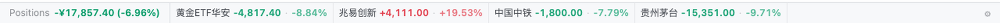
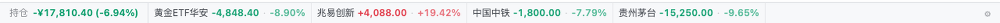
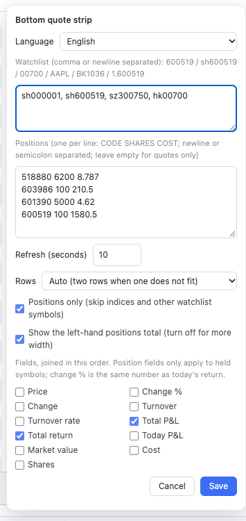

# dsh-stock-strip

A thin, always-on quote bar pinned to the bottom edge of DeepSeek Harness: watchlist price,
change, and — once you enter a position — its unrealised P&L. Red up / green down, no charts,
nothing to click open. Interface in English or 中文, picked from your browser (switchable in settings).



## What it does

- **One line, out of the way**: pinned to the bottom; the transcript and composer shrink to make room.
- **10 s refresh by default**, drops to 60 s while the page is hidden, refreshes immediately on return.
- **Falls back to two rows instead of scrolling**: if one row does not fit, cells split into two
  half-width rows; only when even that overflows does it scroll slowly.
- **Pick your fields**: price, change %, change, turnover, turnover rate, total P&L, total return,
  today's P&L, market value, cost, shares — any subset, in a fixed order.
- **Positions only** (default on): once you enter holdings, indices and other watchlist symbols
  are dropped from the bar.
- Refresh interval 5–120 s; hover pauses the scroll.

## Install

```sh
# inside a DSH session
plugin_manager → action: install_bundle → target: dsh-stock-strip
```

or from the CLI:

```sh
dsh plugin --profile desktop add dsh-stock-strip
```

Refresh the page once. Uninstall:

```sh
plugin_manager → action: remove_bundle → target: dsh-stock-strip
```

## Positions and P&L

Open ⚙ → **Positions**, one per line: **CODE SHARES COST**

```
600519 100 1580.5
00700 200 380
300750 300 260
```

- Rows split on newlines or semicolons; fields split on spaces (also `、`, `，`).
  Thousands separators, `¥` and `$` are tolerated: `518880，6,200，¥8.787`.
- Unrealised P&L = `(price − cost) × shares`; return = `P&L ÷ (cost × shares)`.
- The bar shows `amount · return`, e.g. `-3,087.60 · -5.67%`; hover a cell for cost, shares,
  market value and today's P&L. Amounts keep their cents and returns keep two decimals — nothing is rounded for display.
- A fixed **Positions** cell on the left totals everything.
- **No FX conversion**: CNY, HKD and USD are totalled separately, so a mixed portfolio shows
  several amounts instead of one made-up number.
- Held symbols missing from the watchlist are added to the bar automatically.

## Fields

| Group | Fields | Notes |
|---|---|---|
| Quote | price / change % / change / turnover / turnover rate | change % is the same number as today's return (vs previous close) |
| Position | total P&L / total return / today's P&L / market value / cost / shares | only for held symbols |

When more than one money field is on, each gets a one-letter tag (`T` total, `D` today, `V` value,
`C` cost) so `-751` and `-3,150` cannot be confused.

## One row or two

`Rows` has three settings: **Auto (default) / One row / Two rows**.

Auto measures the single-row layout first; if it does not fit, it switches to two half-width rows
(no scrolling, bar grows from 27 px to 53 px); only if two rows still overflow does it fall back
to one scrolling row.


## Language

The UI follows the browser language and can be pinned to 中文 or English in ⚙ → Language.





## Symbol formats

`600519`, `sh600519`, `600519.SH`, `00700`, `hk00700`, `AAPL`, `usAAPL`, `1.600519`
(Eastmoney secid), `BK1036` (board, or `90.BK1036`).

Watchlist codes are comma / space / newline separated, up to 12.

## Data and disclaimer

1. Primary: Eastmoney public quotes, `push2.eastmoney.com` (JSON, UTF-8, CORS, no key).
2. Fallback: Tencent quotes, `qt.gtimg.cn` — fetched with `fetch` and decoded explicitly as GBK;
   no third-party script is ever injected into the page.

Quotes are free, public, no-SLA snapshot/delayed data and may change or rate-limit at any time.
The plugin polls at a polite cadence (10 s, 60 s when hidden). **For personal reference only — not
investment advice.** P&L is derived from the cost you type in and ignores fees, dividends and taxes.

## Privacy

- Browser-only plugin: the host half is an empty stub — no file access, no tools, no session data.
- The only network calls are the two quote endpoints above, carrying stock codes and nothing else.
- Watchlist, positions and preferences live in `localStorage` (`dsh-stock-strip/v1`).
- No telemetry.

## Structure

| File | Purpose |
|---|---|
| `package.json` | `dsh.bundle.patch` inserts the host row; `dsh.client` loads `./client` in the Web app |
| `cordis.patch.yml` | loader patch, one `stock-strip` row |
| `index.js` | host half: empty stub |
| `client.js` | browser half: the bar, polling, settings panel |

## Limits

- Covers A-shares, Beijing, Hong Kong, US, indices, ETFs and Eastmoney boards; futures, FX and
  off-exchange fund NAVs are not supported.
- US symbols without a market prefix are tried on NASDAQ → NYSE → AMEX.
- Turnover shown as `1.23亿` / `3560万` (or `1.2B` / `356M` in English) — a unit abbreviation, not rounding.
- Requires DSH `>= 0.2.0`.

## License

MIT
