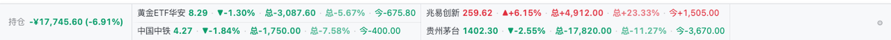

# dsh-stock-strip

A thin, always-on quote bar pinned to the bottom edge of DeepSeek Harness: watchlist price,
change, and — once you enter a position — its unrealised P&L. Red up / green down, no charts,
nothing to click open.

贴在 DeepSeek Harness 窗口最底下的一条行情条：`名称 现价 ▲+1.23%`，有仓位时再带累计浮动盈亏，
红涨绿跌，不用点开、没有 K 线。




## 它能做什么

- **常驻一行，不打断工作**：固定在最底边，正文和输入框会为它让出高度，不遮挡任何东西。
- **默认 10 秒一轮**：页面切到后台自动降到 60 秒，切回前台立刻补一次。
- **放不下就变两行**：单行装不下时自动切成两行（不滚动）；两行也塞不下才退回单行慢速滚动。
- **按需显示字段**：股价、涨跌幅、涨跌额、成交额、换手率、总盈亏、总盈亏比、当日盈亏、
  持仓市值、成本价、股数，勾哪个显示哪个。
- **只看持仓**：配了持仓就只画持仓票，不把自选里的指数一起摊上去。
- **可配置刷新间隔** 5–120 秒；悬停暂停滚动。

## 安装

```sh
# 在 DSH 会话里
plugin_manager → action: install_bundle → target: dsh-stock-strip
```

或命令行：

```sh
dsh plugin --profile desktop add dsh-stock-strip
```

装完刷新一次页面即生效。卸载：

```sh
plugin_manager → action: remove_bundle → target: dsh-stock-strip
```

## 持仓与浮动盈亏

在 ⚙ 的「持仓」里一行一只：**代码 股数 成本价**

```
600519 100 1580.5
00700 200 380
300750 300 260
```

- 行之间用换行或分号（`;` / `；`），字段之间用空格（也认 `、` 和全角 `，`）；
  数字里带千分位、`¥`、`$` 都能识别，比如 `518880，6,200，¥8.787`。
- 每行的浮盈 = `(现价 − 成本价) × 股数`，盈亏率 = `浮盈 ÷ (成本价 × 股数)`。
- 条上显示「金额 · 盈亏率」，例如 `-3,087.60 · -5.67%`，鼠标悬停看成本 / 股数 / 市值明细。
  **金额保留到分、比率保留两位**，不做取整或省位。
- 左侧固定一格「持仓」显示汇总：单一币种时带盈亏率，比如 `-¥17,745.60 (-6.91%)`。
- **不做汇率换算**：A 股按 CNY、港股按 HKD、美股按 USD 各自汇总，分别显示，
  混着持有时会看到多个金额，而不是一个被汇率糊弄过的合计。
- 只填了持仓、没加进自选的票会自动出现在条上。
- 不填持仓就退回纯行情条：没有盈亏、没有汇总。

## 显示字段

每只票显示哪些字段由你勾选，按下面的顺序拼接（`·` 分隔）：

| 分组 | 字段 | 说明 |
|---|---|---|
| 行情 | 股价 / 涨跌幅 / 涨跌额 / 成交额 / 换手率 | 涨跌幅就是**当日盈亏比**（相对昨收），两个名字是同一个数 |
| 持仓 | 总盈亏 / 总盈亏比 / 当日盈亏 / 持仓市值 / 成本价 / 股数 | 只对有仓位的票生效 |

同时勾了多个金额字段（总盈亏 / 当日盈亏 / 市值 / 成本）时，会自动加一个字的前缀
`总` / `今` / `值` / `本` 区分；只勾一个时不加。

## 单行还是两行

`行数` 有三档：**自动（默认）/ 单行 / 两行**。

自动模式的取舍顺序：

1. 先按单行排版，量一下放不放得下；
2. 放不下就切两行（每格半宽、按内容宽度对齐，不滚动），条高从 27px 变成 53px；
3. 两行也塞不下（比如 8 只票 × 5 个字段）时，才退回单行 + 慢速滚动。

实测（1280px 宽、4 只持仓）：单行 2 个字段不滚；5 个字段单行会滚、两行正好放下且不滚。
选了「两行」就强制两行，哪怕单行放得下。

## 代码写法

`600519`、`sh600519`、`600519.SH`、`00700`、`hk00700`、`AAPL`、`usAAPL`、
`1.600519`（东财 secid）、`BK1036`（板块，也可写 `90.BK1036`）。

自选代码用逗号 / 空格 / 换行分隔，最多 12 个。

## 数据来源与免责声明

1. 主路径：东方财富公开行情接口 `push2.eastmoney.com`（JSON、UTF-8、带 CORS、无需 key）。
2. 兜底：腾讯行情 `qt.gtimg.cn`（`fetch` 取回后用 `TextDecoder('gbk')` 显式解码，
   不在页面里注入任何第三方脚本）。

两条都不通时保留上一次快照并显示「行情暂不可用」。

行情接口是**公开、免费、无 SLA** 的快照/延时数据，随时可能变更或限流；本插件按自己的节奏轮询
（默认 10 秒、后台 60 秒），不做高频请求。**数据仅供自己看，不构成任何投资建议**，
盈亏数字由你填的成本价推算，不含手续费、分红与税费。

## 隐私与权限

- **纯前端插件**：Host 半边是空实现，不读写任何宿主文件、不注册工具、不发送会话内容。
- 唯一的网络请求是上面两个行情接口，只带股票代码，不带任何账号或会话信息。
- 自选、持仓、显示偏好只存在浏览器 `localStorage`（键 `dsh-stock-strip/v1`）。
- 不收集遥测。

## 结构

| 文件 | 作用 |
|---|---|
| `package.json` | `dsh.bundle.patch` 插入 Host 行，`dsh.client` 让 Web 端加载 `./client` |
| `cordis.patch.yml` | Loader 补丁，一行 `stock-strip` |
| `index.js` | Host 半边：空实现（行情全在浏览器侧取） |
| `client.js` | 浏览器半边：底边条、轮询、设置面板 |

## 已知边界

- 覆盖 A 股 / 北交所 / 港股 / 美股 / 指数 / ETF / 东财板块；期货、外汇、场外基金净值不支持。
- 美股不写市场时按 NASDAQ → NYSE → AMEX 依次尝试。
- 成交额按 `1.23亿` / `3560万` 展示（单位缩写，非取整）。
- 需要 DSH `>= 0.2.0`。

## License

MIT
